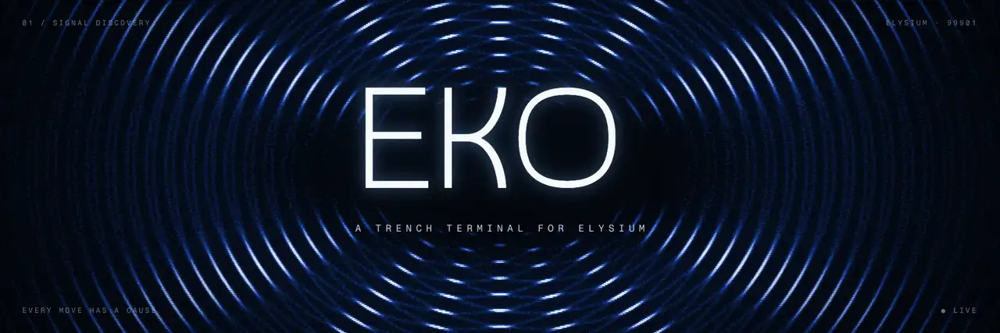

<p align="center">
  <a href="https://ekoterminal.com"></a>
</p>

<p align="center">
  <a href="LICENSE"></a>
  <a href="#licence"></a>
  <a href="https://ekoterminal.com"></a>
  
  
  
</p>

**EKO** watches every new token on Elysium and tells you, before you buy, whether you could sell it again. Each launch
gets a buy-then-sell simulation against its real pool, a read of who holds it and what its deployer can still change,
and a verdict (**Clear**, **Monitor** or **Danger**) with a receipt of what was checked, at which block.

> Not financial advice. A verdict describes buyer risk at one block; it is not a recommendation to buy.

## What it does

| | |
|---|---|
| **Radar** | Live coins ranked by the last hour's trading, each with its verdict and the cost of getting in and out at $1,000. |
| **New pairs** | Launches in three columns: New, About to graduate and Graduated, with progress to graduation. |
| **Coin pages** | Chart and trades, the sell check, top holders and bundles, the deployer's powers and past launches. |
| **Scan** | Paste any token address for a check. |
| **Trading** | Connect a wallet and buy or sell from the coin page, with the check run again before each trade. |
| **Scoreboard** | Every call EKO has made, and what happened to the coin after. |

## How it works

The live site is one service, [`apps/edge`](apps/edge): it follows Elysium's chain head, keeps recent launches in
memory, runs the checks and serves the web app ([`apps/web`](apps/web)).

| Path | What is there |
|---|---|
| [`apps/edge`](apps/edge) | The live server: chain tracker, checks, graduation, the read API |
| [`apps/web`](apps/web) | The terminal (React, Vite) |
| [`packages/chain`](packages/chain) | Elysium contracts, launchpad decoders, the sell-check simulation, the metered RPC client |
| [`packages/playbooks`](packages/playbooks) | The rules behind each verdict |
| [`packages/receipts-verifier`](packages/receipts-verifier) | Checks a verdict's receipt independently |
| [`packages/shared`](packages/shared) | API contracts and feature flags |
| [`contracts`](contracts) | Solidity: the receipts registry (not yet deployed) |
| [`docs`](docs) | Architecture, design and security notes |

Other apps (`apps/server`, `apps/indexer`, `apps/engines` and the rest) are the earlier, larger deployment and are not
used by the live site.

## Running it

Requires Node.js 22.12 or newer and pnpm 11.5.1.

```sh
pnpm install --frozen-lockfile
pnpm --filter @eko/web build                   # the terminal the edge serves
pnpm --filter @eko/edge start                 # http://localhost:8080, on Elysium's public RPC
pnpm --filter @eko/edge test
```

The edge's settings are listed at the top of [`apps/edge/src/main.ts`](apps/edge/src/main.ts).

## Updates

Features still to come ship behind flags (see [`docs/FLAGS.md`](docs/FLAGS.md)), and land here as they go live:
leaderboards, referrals, paid plans, Loop Lab backtests, research, perps and Arena.

## Security

Please report vulnerabilities privately, as described in [SECURITY.md](SECURITY.md). Do not open a public issue.

## Licence

EKO is source-available under the [PolyForm Noncommercial Licence 1.0.0](LICENSE). You may read, run, change and share
it for any **non-commercial** purpose: personal use, study, research, hobby projects, and use by charities, schools
and public bodies. **Commercial use is not permitted** under this licence; to ask about it, open an issue.

Third-party code keeps its own licence: the libraries under `contracts/lib` and every dependency (see [NOTICE](NOTICE)).

<sub>Built on Elysium. EKO is not affiliated with the projects whose tokens it rates.</sub>
