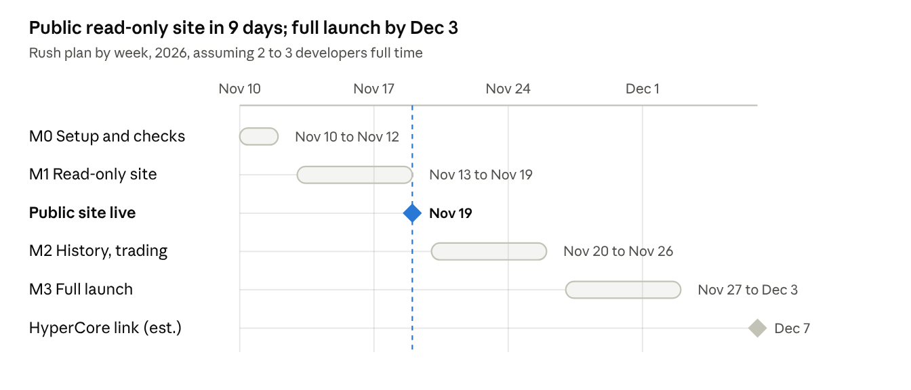

# Elysium terminal: team overview

Nov 10, 2026 · Working name, not final

## What we're building

A scam scanner and trading terminal for memecoins on Elysium, Kinetiq's new chain on top of Hyperliquid. It gives every new coin a verdict (Clear, Monitor or Danger), names the scam pattern it matches, and refuses to route a buy into a coin it flags as a honeypot.

It is the EKO idea, rebuilt light. People use it as a website. AI trading agents (Claude, ChatGPT, Cursor and others) use the same checks through a connector, so the agent checks a coin before it buys.

**Who it's for**

- Memecoin traders on Elysium who want a radar of new launches with a verdict on each.
- People running trading agents who want a check in front of every order.

**What it is not:** a wallet, a fund or a copy-trading service. Users keep their own keys and sign their own trades; we never hold funds. EKO for Robinhood Chain stays a separate project and is not changed by this work.

## Why Elysium, why now

Elysium went live on 2026-11-09 and is already launching about 36,000 coins a day, and the best-known token-safety services (GoPlus, Honeypot.is) don't support it yet. We found no tool on Elysium that labels AI-agent wallets or checks token text for prompt injection. We measured these numbers ourselves on mainnet on 2026-11-10.

| What we measured | Value |
| --- | --- |
| New coins (v4 pools created) | about 2,900 in 1.9 hours, so roughly 36,000 a day |
| Swaps on the main pool manager since launch | about 1.14 million in roughly 40 hours |
| Share of launches on the top two launchpads | about 90%: Montra 57%, and an unbranded launcher run by about 20 copy-bot wallets 33% |
| Block time | about 111 ms |
| Transactions paying a priority fee | 79% of a 395-transaction sample; the top bid was about 900 times the base fee |

The last row matters most for the product. Elysium orders transactions by priority fee, so snipers bid against each other in the launch block. Who paid a large tip at launch is a strong, cheap scam signal.

Elysium is not run by Hyperliquid. It is a separate chain built by Kinetiq, uses HYPE for gas and posts its data to HyperEVM. A link to Hyperliquid's own order books (read prices and depth, place orders) is planned about four weeks after launch ([Elysium docs](https://elysium.kinetiq.xyz/docs/what-is-elysium)). That is our second act: guarding agents that trade perps on Hyperliquid.

## The product experience

The website stays the front door and feels like EKO: open it, watch new coins appear, click one, see its verdict. Nothing to install.

1. **Radar.** A live list of new launches across the main Elysium launchpads, each with its verdict, age, liquidity and how much of the early buying came from bots or snipers.
2. **Coin page.** The verdict with the scam patterns it matched in plain words, a buy-then-sell test (can you actually sell, and at what tax), the deployer's track record, flagged wallets among the holders, and a price chart.
3. **Trade.** Connect your own wallet and buy or sell from the coin page. A coin flagged Danger as a honeypot is refused, not just warned about.
4. **Agent connector.** A connector URL on our own domain that people paste into Claude, Cursor or another AI app. Their agent gets the same tools: verdict, coin card, buy-then-sell test and a pre-trade check.
5. **Scoreboard.** A public page counting honeypots we refused and honeypots we missed, rebuilt from our data every hour.

The check on a coin runs in the visitor's browser the moment they open it, so a brand-new coin has a verdict within seconds with no waiting for data to catch up. Deployer and wallet history comes from a small data file we publish and refresh often.

## How it differs from EKO

We keep EKO's checks and look, and drop the heavy backend that made it slow, costly and exposed. EKO stored every swap, transfer and block since genesis in about 100 database tables, had to backfill before it was useful, and kept signing keys on a hosted platform that was breached in October.

| | EKO (Robinhood Chain) | This build (Elysium) |
| --- | --- | --- |
| Where a coin is checked | Our servers, from a big database | The visitor's browser, live from the chain |
| What we store | Every swap, transfer and block since genesis | Conclusions only: deployers, launch outcomes, flagged wallets, crew links |
| Raw data kept | Forever | About 72 hours, then summarised and deleted |
| Waiting before it works | Backfill from genesis | None: the chain is one day old and a coin is checked on demand |
| Servers | API, indexer, workers, Postgres, bots, receipts | One small private builder machine plus a small edge proxy |
| Secrets we hold | RPC, LLM and bot keys, a funded signer | A read-only RPC key and a snapshot-signing key |
| If our server goes down | The product is down | The site still works; history is just older |

**What we give up at launch:** Telegram and X bots, on-chain receipts, the LLM forecast swarm, paid tiers and long-history leaderboards. Each can come back later as a small add-on.

## What we checked so we don't get blocked

We can build and run all of this without ID checks, a company or big up-front costs: about $110 to $140 a month, paid in crypto where it matters. We checked every service on 2026-11-10 before planning around it.

| Need | What we'll use | ID or company? | Monthly cost |
| --- | --- | --- | --- |
| Chain data, including transaction traces | dRPC | Not stated; wallet or email login; crypto accepted | $49 |
| Builder server | FlokiNET VPS | No ID, crypto accepted | about €54 |
| Website, proxy, CDN | Cloudflare free plan | None documented | $0 |
| Domain | Njalla | No ID, crypto accepted | about €15 a year |
| Wallet connection | Browser wallets directly | No account at all | $0 |
| Hyperliquid data (later) | Hyperliquid's public API | No key | $0 |

**What we deliberately avoid**

- **Alchemy:** needs a credit card for anything beyond a free tier that is too small for Elysium.
- **Running our own chain node:** possible, but an estimated 10 to 20 GB of new disk a day. Too heavy for a rush.
- **Hetzner, Contabo, OVH, Hostinger:** ID checks, or the right to demand them at any time.
- **WalletConnect:** needs an account. At launch, phone users open the site in their wallet app's browser instead.
- **ChatGPT's app directory:** listing needs a government ID check. We launch the agent connector for Claude and Cursor, which need no review.

Three things are not confirmed yet and get checked on day one: that dRPC and Cloudflare's free plan ask for no ID or card at signup, and that our chosen VPS plan is available.

Prices, sources, fallbacks and what we ruled out are in the backend build doc ([02-backend-build-doc.md](02-backend-build-doc.md)).

## Rush plan

A public read-only site by 2026-11-19 and the full product by 2026-12-03, if two or three developers work on it full time. With one developer, roughly double every date.

- **M0 Setup and checks:** new repo, accounts opened, launchpads identified, every contract address checked.
- **M1 Read-only site:** radar and coin pages with live verdicts. This is the first public launch.
- **M2 History, trading:** deployer and crew history, buying and selling from your own wallet, the agent connector.
- **M3 Full launch:** scoreboard, the remaining checks, charts for older coins, the downloadable connector.
- **HyperCore link:** Elysium says about four weeks after mainnet; the date is our estimate. Our perps work starts when it ships.

## Risks and open decisions

The biggest risks are speed and accuracy, not money or access: the window is weeks, and one confident wrong verdict costs more trust than a missing feature.

| Risk | What we do about it |
| --- | --- |
| Others get there first: GMGN reportedly supports Elysium, and a Telegram bot claims honeypot checks | Ship the read-only site by Nov 19; lead with what nobody else does (agent-wallet labels, prompt-injection checks, published misses) |
| A scam token detects our simulated sell and behaves differently on a real one | Run more than one probe style, compare results, and publish every miss on the scoreboard |
| Launchpads change weekly; one big launcher is unbranded and Ascend's contracts are still unmapped | Check every hook on the known pool managers by default, and run a weekly scan for new pool managers |
| Elysium itself is two days old, with one sequencer and approved validators only | Nothing to do but watch; if the chain stalls, the site shows it plainly |
| One RPC provider | Kinetiq's public RPC and Chainstack are tested fallbacks |
| Success outgrows Cloudflare's free tier (100,000 requests a day) | Move the proxy onto our own server behind the same tunnel; no payment needed |
| The plan assumes 2 to 3 full-time developers | With fewer, cut M3 first; M1 and M2 are the product |
| Clones of our site appear (Elysium already has phishing launchpad sites) | Publish official links in one place; never ask anyone to sign anything except a trade they started |

**Decisions we need from the team**

- [ ] Name and domain (the domain should be bought by M0)
- [ ] Token or no token. Recommendation: no token and no trading fee at launch; revisit after M3
- [ ] Join Montra's builder programme? It pays a share of Montra's 0.4% fee on launches made through us, but asks for identity once payouts pass a threshold
- [ ] Team size and who owns the builder, the site and the connector
- [ ] Whether EKO on Robinhood Chain later moves onto this same light stack

## Rules for public copy

These carry over from EKO and apply to the site, posts, docs and the connector's tool descriptions.

| Say | Never say |
| --- | --- |
| "Built on Elysium" plus: not affiliated with, endorsed by or connected to Kinetiq or Hyperliquid | "Official", "partner", "Hyperliquid's scanner", or using their logos |
| "Flags scam patterns", "refuses buys into coins flagged as honeypots" | "Safe", "rug-proof", "guaranteed", "100%" |
| "Honeypots refused and honeypots missed are both published" | Win rates, returns, "alpha", price predictions |
| "Reviewed with automated tools" (if true) | "Audited" (we have no paid audit) |
| "Non-custodial: you sign your own trades; we never hold funds or keys" | "Trustless", "no KYC" as a selling point |
| "Planned" or "coming in milestone N" for unbuilt features | Describing unshipped features as live |

Every page with a verdict carries: DYOR · Not financial advice · Automated analysis can be wrong. The team stays anonymous: no names, handles or personal details anywhere public, including code and commit history.
