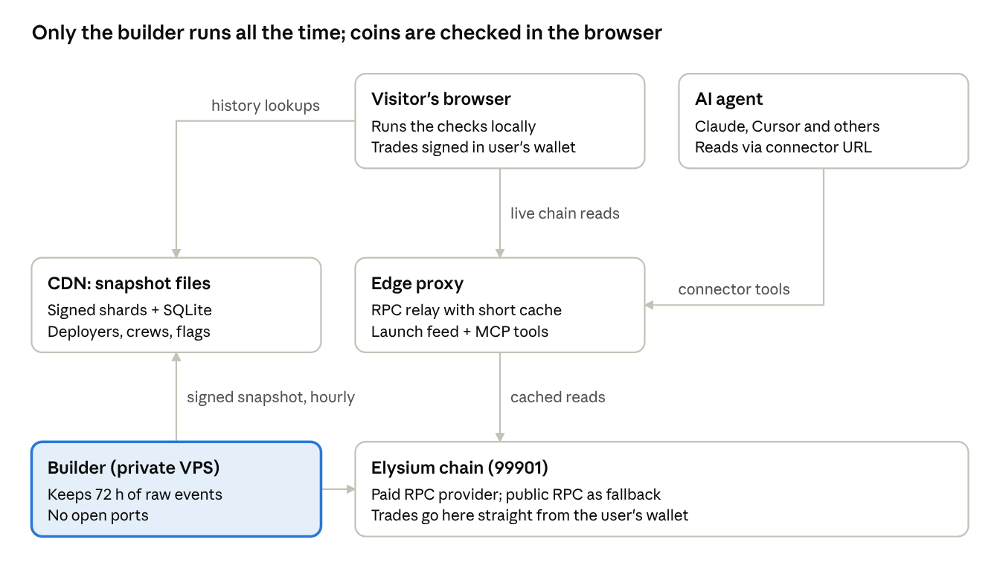

# Elysium terminal: backend build doc

Nov 10, 2026 · For the dev team · Working name, not final

## Architecture at a glance

The browser does the checking and the user's wallet does the trading; we run one private builder and one small proxy, and publish everything else as static files.

## Tech stack

One TypeScript monorepo, the same toolchain as EKO, so the team and the copied code need no relearning. Versions are EKO's pinned ones as of 2026-11-10.

| Layer | Choice | Notes |
| --- | --- | --- |
| Language, runtime | TypeScript 6, Node.js 22.12+, pnpm 11 | Same as EKO; lockfile committed |
| Chain client | viem 2.56 | Used in browser, edge proxy and builder alike |
| Web app | React 19, Vite 8, TanStack Query 5, zustand 5 | Built to static files; no server rendering |
| Wallets | wagmi 3 with injected wallets (EIP-6963) | No third-party wallet service needed at launch |
| Charts | lightweight-charts 5 | Already in EKO's UI |
| Shared logic | `policy`, `playbooks`, `untrusted`, `signal` packages | Pure functions, run unchanged in browser, proxy and builder |
| Edge proxy and connector | One small serverless function (TypeScript) | Read-only RPC relay, short cache, read-only MCP tools |
| Builder | Node 22 service with SQLite (better-sqlite3) | Runs on one VPS under Docker Compose |
| Snapshot files | Static JSON shards plus a SQLite file | Served from the builder through a Cloudflare Tunnel, cached at the edge |
| Sell-test probe | Solidity probe contract, built once with Foundry | Injected through `eth_call` state overrides, never deployed |
| Tests | vitest; pinned chain fixtures | Same as EKO |
| CI | GitHub Actions: typecheck, tests, brand and claims check, secret scan | Copied from EKO |

No Postgres, no queue, no LLM in the request path, and no contracts to deploy at launch.

## Chain facts we verified

Everything here was measured on Elysium mainnet on 2026-11-10 against the public RPC and explorer, unless a source is linked. Re-run the probe before relying on any of it.

| Item | Value | How we know |
| --- | --- | --- |
| Chain ID | 99901 (testnet 99801) | `eth_chainId` returned `0x1863d` |
| Client | Arbitrum Nitro (`nitro/vlocal`), ArbOS 61 per docs | `web3_clientVersion`; [docs](https://elysium.kinetiq.xyz/docs/what-is-elysium) |
| Public RPC | `https://rpc.elysium.kinetiq.xyz` (HTTP only listed) | [docs](https://elysium.kinetiq.xyz/docs/connecting-to-elysium) |
| Block time | about 111 ms (10,000 blocks in 1,113 s) | block timestamps |
| Base fee | about 0.5 gwei; gas limit huge, 32M per block per docs | latest block; [docs](https://elysium.kinetiq.xyz/docs/blocks-fees-and-ordering) |
| Ordering | by priority fee; 79% of sampled txs tip; top tip about 441 gwei | receipts of 100 blocks; docs |
| Archive reads | work on the public RPC (balances at block 1,000) | `eth_getBalance` at old blocks |
| `eth_call` with state overrides | works on the public RPC | code-override call returned 42 |
| `eth_getBlockReceipts` | works | direct call |
| `eth_getLogs` | wide block ranges allowed, capped at 10,000 logs per call | error `-32005` above the cap |
| `debug_*`, `trace_*` | blocked without an API key | error `-32401` |
| Explorer API | Etherscan-style at `/explorer/api`, `getsourcecode` works without a key | direct calls |
| Batches to HyperEVM | about every 15 minutes; `finalized` lags `latest` that much | docs |
| Withdrawal challenge period | about 5.5 days | docs |

**Contracts that matter**

| Contract | Address | Notes |
| --- | --- | --- |
| WHYPE | `0xbA876237B0F021A6c6D852d6c26E107997cC5E81` | docs |
| USDC | `0xb47c4C8F73F009CC0C0d3f92B388d13E293F0B65` | docs warn look-alikes exist |
| Multicall3 | `0xcA11bde05977b3631167028862bE2a173976CA11` | docs |
| Permit2 | `0x000000000022D473030F116dDEE9F6B43aC78BA3` | docs |
| PoolManager A (main) | `0xe2e105d3f7209a9da11f83ccf3e7398a753823f1` | official Uniswap v4 (on Uniswap's deployment list); ~43.5k pools, ~1.14M swaps in ~40 h |
| PoolManager B | `0x06c63714fbf1f5753017123e2fcfdede4540b2c4` | not official: one wallet deployed it together with launch hook 2; ~12.9k pools |
| Launch hook 1 | `0x6b1216a40b65c83e9c9e18a562c446697b8cf8ec` | Montra, confirmed through Montra's on-chain registry; factory 0x38d3…cd15; 57% of new pools; dynamic fee; paired with native HYPE |
| Launch hook 2 | `0xb3e25cdf4a2f42e7f37ab3ae43bfb90ee8052acc` | brand unknown; on PoolManager B; 33% of new pools; 1,156 recent launches came from just 20 wallets, mostly copies of Solana pump.fun coins |
| TaxLaunchHook | `0x3ea9581a32a396f69b177b65b91149cf887beacc` | verified; about 2% of new pools |
| Ramses V3 factory | `0x29cd8852ff040cfe74fb20277a121ed1293afb41` | verified; most v3 pools |

**Also confirmed:** Universal Router v2.2.0 at `0x1B34…C1a` and Permit2 are on [Uniswap's deployment list for Elysium](https://developers.uniswap.org/docs/protocols/v4/deployments.md), so trades can route through it. Smaller launchpads: BloomLaunch (CoreProxy `0x42ba…1911`, bonding curve, then a v4 pool) and IMORTAL (HyperForge `0xd5f8…0c13`). Montra documents its contracts at [montramarkets.xyz/docs/contracts](https://montramarkets.xyz/docs/contracts).

**Still unknown:** the brand behind launch hook 2 and TaxLaunchHook; Ascend's mainnet contracts (a third-party ranking puts it second by volume, and it may use a PancakeSwap-style pool manager that our v4 scan doesn't see); the HyperCore precompile address (none announced).

## Components

Four pieces; only the builder runs all the time, and nothing holds user funds or user keys.

### 1. Web app (static files)

- Runs the checks in the visitor's browser: loads a coin's own pool events and token info through the proxy, runs the sell probe through `eth_call`, applies the playbooks, then looks up deployer and wallet history in the snapshot shards.
- Trading: builds the swap transaction and the user's wallet signs and sends it. A coin with a Danger honeypot verdict gets no buy button.
- Shows the radar from the proxy's shared launch feed.

### 2. Edge proxy (serverless function)

- **RPC relay:** forwards only read methods (`eth_call`, `eth_getLogs` with a bounded range, blocks, receipts, code, balances, `eth_chainId`) to the paid RPC. Holds the read-only RPC key; the browser never sees it.
- **Short cache:** identical requests within 10 to 30 seconds are answered from cache, so a hundred viewers of one coin cost one upstream call.
- **Shared launch feed:** polls launch events once a second and serves the same answer to every viewer, so radar cost doesn't grow with users.
- **Agent connector:** serves the read-only MCP tools (`coin_verdict`, `coin_card`, `sell_test`, `preflight`) over Streamable HTTP, stateless, no login.
- Per-IP rate limits on every route.

### 3. Builder (one VPS, no open ports)

- Follows the chain by logs only: launch-hook pool creations, swaps and transfers for coins under 72 hours old.
- Works out outcomes (rugged, honeypot, dead, alive), flags snipers, bundlers and crews, updates deployer records.
- Every 15 minutes writes the delta files; every hour rebuilds the shards and the manifest, signs it and serves the files through an outbound Cloudflare Tunnel, so the box still has no open ports.
- Reached only over SSH through a private network (Tailscale); secrets encrypted at rest with sops and age, as planned for EKO's VPS.

### 4. Local MCP (after launch)

An npm package with the same tools, reading the SQLite snapshot locally, for people who want no dependency on our proxy.

### Secrets

| Secret | Lives on | If it leaks |
| --- | --- | --- |
| Paid RPC key (edge) | Edge proxy settings | Someone spends our RPC credit; a spend cap limits the damage |
| Paid RPC key (builder) | Builder, encrypted | Same |
| Snapshot signing key | Builder only, encrypted | Someone could publish false history; history can only raise verdicts, so it can't hide a scam |
| Deploy credentials (hosting, CDN) | Team password manager | Site defacement; rotate and redeploy |

## Data model

We store conclusions, never raw history. The chain is the raw database; we keep only what took work to figure out. Raw events live on the builder for about 72 hours, long enough to see how a coin ended up, then get summarised and deleted.

**Published tables (the snapshot)**

| Table | One row per | Columns |
| --- | --- | --- |
| `deployers` | wallet that launched a coin | launches, bad outcomes, playbooks hit, crew id, first and last seen block |
| `launches` | coin that survived pruning (below) | token, deployer, launchpad, hook, launch block, outcome, playbook tags, peak liquidity bucket |
| `flagged_wallets` | flagged wallet only | reason (sniper, bundler, crew funder, insider, agent), crew id, first seen, evidence tx |
| `crew_links` | funding link between flagged wallets | funder, funded, amount bucket, block |
| `bad_code` | contract code hash | why it is bad (honeypot template, malicious hook), first seen |
| `bars_1h` | hour of trading for a surviving coin, last 30 days | open, high, low, close in HYPE, volume |

**Pruning rule.** A launch keeps its own row only if it was flagged, reached a minimum liquidity, or its deployer has other launches. Everything else becomes a counter on the deployer's row. Most of the ~36,000 daily launches die within hours, so most become a counter.

**Size budget (estimate, measure in week 1).** If about 10% of launches keep a row at roughly 300 bytes, that is about 1 MB a day, or about 400 MB a year before compression. Raw events on the builder stay flat at about 72 hours of chain activity.

**How it is published**

- **For the website:** JSON shards split by the first two hex characters of the address (256 files per table), so looking up one deployer fetches one small file from the CDN.
- **For the local MCP and power users:** one SQLite file plus hourly delta files.
- **Integrity:** a manifest lists every file's hash and is signed with an ed25519 key held only on the builder. Clients refuse files that don't match.
- **Safety rule:** history can only raise a verdict, never lower it. A poisoned snapshot can cause false alarms but cannot hide a scam that the live check sees.

## Scam checks

Most of EKO's 13 playbooks port as they are; three were Pons-specific and get Elysium replacements. Launch week ships the checks marked **Launch**; the rest follow.

| Check | Status on Elysium | Ships |
| --- | --- | --- |
| Honeypot (buy then sell fails) | Ports; simulated with `eth_call` plus state overrides | Launch |
| Tax trap (high or changeable sell tax) | Ports; also covers hook fees, since the top launchpad uses dynamic-fee pools | Launch |
| Malicious v4 hook | Ports; very relevant, every launch goes through a hook | Launch |
| Fee-trap pool (extreme fee tier) | Ports; read the pool's fee and the dynamic-fee flag | Launch |
| Removable or fake liquidity | Ports; check who controls the v4 position | Launch |
| Serial deployer or crew | Ports; uses the snapshot | Launch |
| Agent bait (prompt injection in token name or metadata) | Ports as is (`packages/untrusted`) | Launch |
| **New: launch-block snipers** | Wallets paying large priority fees in the first blocks of a launch | Launch |
| **New: look-alike quote token** | Pools paired with a fake USDC or WHYPE instead of the real ones | Launch |
| Bundle and dump | Ports; same-funder wallets buying in the first blocks | Week 2 |
| Clone swarm | Ports; name and symbol copies, including of other launches | Week 2 |
| Wash volume to trend | Ports in a weaker form, using the 72-hour window | Week 3 |
| Holder concentration, dev dump | Port (added to EKO's rules in October) | Week 2 |
| Stuck at bonding | Only if a launchpad turns out to use a bonding curve | When found |
| Migration dump | Becomes "dump at HyperCore listing" once that link exists | After the HyperCore upgrade |
| Exemption-wallet insiders | Pons-only, dropped | No |

Every check returns the same shape EKO's do: a level (Info, Monitor, Danger), the evidence (transactions and addresses), and the rules version, so the verdict is reproducible. Montra launches can open with a 99% anti-snipe fee that falls to the normal fee over 5 seconds to 30 minutes; the tax check must read the current fee and label it temporary rather than a tax trap, as EKO did for Pons.

## Services, accounts and cost

Everything we need can be bought without ID, a selfie or a company, for roughly $110 to $140 a month. No service in the chosen stack states a KYC requirement. A few never say either way; those are flagged as checks for day one. Researched 2026-11-10.

**Chosen stack**

| Need | Choice | ID or company needed? | Pay with | Cost | Source |
| --- | --- | --- | --- | --- | --- |
| RPC with traces | dRPC Pro | Not stated; login by wallet or email | Crypto or card | $49/mo for 10M requests (Pay as You Go: $6 per 1M) | [pricing](https://drpc.org/pricing), [chain page](https://drpc.org/chainlist/elysium-mainnet-rpc) |
| Builder VPS (8 cores, 8 GB, 180 GB NVMe) | FlokiNET VPS V, Romania | No: "do not need any personal information" | BTC, ETH, XMR and others | about €54/mo | [FlokiNET VPS](https://flokinet.is/vps) |
| Edge proxy and static site | Cloudflare Workers and Pages, free plan | None documented | None needed on the free plan (verify) | $0 (100k requests a day) | [Workers limits](https://developers.cloudflare.com/workers/platform/limits/), [Pages limits](https://developers.cloudflare.com/pages/platform/limits/) |
| Snapshot files | Served from the builder through a free Cloudflare Tunnel, cached at the edge | None | None | $0 | Avoids R2, which needs a payment method |
| Domain | Njalla | No: email signup | BTC, ETH, XMR | about €15/yr for .com | [Njalla pricing](https://njal.la/pricing/) |
| Wallet connection | wagmi injected wallets (EIP-6963) | None, no account at all | n/a | $0 | [wagmi createConfig](https://wagmi.sh/core/api/createConfig) |
| Code, CI | GitHub (public or free org), npm with 2FA | No ID documented | n/a | $0 | [GitHub Actions billing](https://docs.github.com/en/billing/concepts/product-billing/github-actions) |
| Sanctions list | Open-source OFAC address lists, updated nightly | None | n/a | $0 | [0xB10C list](https://github.com/0xB10C/ofac-sanctioned-digital-currency-addresses) |
| Hyperliquid data (M4) | Public info API | None, no key | n/a | $0; 1,200 weight a minute per IP | [rate limits](https://hyperliquid.gitbook.io/hyperliquid-docs/for-developers/api/rate-limits-and-user-limits) |

**RPC sizing (estimate).** The builder polls logs about once a second (about 2.6M requests a month). The edge proxy, with its 10 to 30 second cache, should stay near 200k upstream calls a day at launch (about 6M a month). That fits dRPC Pro; at 4 to 5 times the traffic, dRPC Scale is $199 a month.

**Fallbacks, already checked**

- **RPC:** Chainstack ($49 Growth for debug, crypto top-ups via NOWPayments, but falls back to charging a card) and Conduit Nodes ($50 a month for 1B compute units; payment methods not stated). The public Kinetiq RPC covers everything except traces.
- **VPS:** 1984 Hosting (Iceland; 4 vCPU, 8 GB, 160 GB for about €70) or BitLaunch (crypto only; prices only shown after signup).
- **Edge:** if Cloudflare asks for a card, run the proxy on the builder VPS behind the same Tunnel. It costs nothing extra but makes the builder box serve traffic.

**Ruled out, and why**

| Service | Problem |
| --- | --- |
| Alchemy | Pay as You Go needs a credit card; the free tier allows only 10 blocks per `eth_getLogs` call (about 1 second of Elysium) |
| Our own Elysium node | Possible (Conduit publishes the config) but an estimated 10 to 20 GB of disk a day and 16 to 32 GB of RAM; not for a rush build |
| Hetzner, Contabo, OVH | ID checks before the first order, and no crypto |
| Hostinger | Can demand ID at any time and suspend after 7 days; needs 24 months up front |
| Cloudflare R2, Workers Paid | Need a payment method (PayPal or screened USDC) |
| Vercel Hobby, GitHub Pages | Their terms forbid commercial use |
| WalletConnect (Reown) | Needs an account and project ID; skipped at launch, so mobile users use their wallet's built-in browser |
| ChatGPT app directory | Publishing needs OpenAI identity verification (government ID through Persona). Claude and Cursor connectors need no review, so we launch with those. |

## What we reuse from EKO

We copy selected EKO packages into a new repo; we don't fork the whole thing. The frozen EKO-RH copy is reference only and never edited. EKO is our own MIT-licensed code, so reuse is clear.

| EKO part | Size (TS lines) | Plan | Why |
| --- | --- | --- | --- |
| `packages/policy` (preflight) | ~1,300 | Copy as is | Pure, no Node imports, runs in the browser |
| `packages/playbooks` (rules, verdict) | ~2,600 | Copy, strip Pons fields, add new checks | Pure; rules reference Pons in a few places |
| `packages/untrusted` (agent-bait text checks) | ~400 | Copy as is | Pure |
| `packages/signal` | ~700 | Copy as is | Pure |
| `packages/shared` (types, zod) | ~6,200 | Copy the parts we use; replace the hard-coded `chainId: 4663` with a chain profile | 205 EKO files hard-code 4663 |
| `apps/web` (React UI) | ~22,000 | Copy screens, design system and wallet code; rewrite the data layer | 15 files call the EKO API, which no longer exists |
| `packages/chain` | ~11,800 | Keep the launchpad adapter interface, v4 decoding, the V4 probe contract and the live sell check; drop Pons, Flap, Klik, Occupy and the Anvil fork tooling | EKO's `sell-check.ts` already runs the never-deployed V4 probe inside one `eth_call` with state overrides, which works on Elysium's public RPC |
| `apps/indexer` | ~6,600 | Basis for the builder's ingest (logs-first head follower, reorg handling) | Cut to launchpad and pool events only |
| `apps/engines` | ~24,000 | Take wallet fingerprinting and crew clustering into the builder | Drop the swarm, receipts and Postgres writers |
| `apps/mcp` | ~2,300 | Reuse tool definitions; serve read-only tools from the edge proxy | No OAuth needed for read-only tools |
| `apps/server`, `packages/db`, contracts, bots | ~46,000 | Leave behind | Hosted API, Postgres and on-chain receipts are what we're dropping |
| Brand, claims and secrets checks in CI | small | Copy | Cheap insurance against bad copy and leaked identifiers |

Roughly a third of EKO's 116,000 lines comes over, most of it the web UI; the pure check logic is only about 5,000 lines.

## Build order

Four milestones to a full launch by about 2026-12-03, then the HyperCore work once Elysium ships that upgrade. Dates assume two or three developers working full time; with one, roughly double them. Each milestone ends with something live.

1. **M0 · Setup and checks (Nov 10–12).** New repo with the copied packages and a chain profile for 99901. Port EKO's `verify:chain` as a probe CLI and run it in CI. Accounts open (see Services). Decode Montra's and launch hook 2's events. Confirm the Universal Router and every other Uniswap address against Uniswap's official list.
    - Done when: CI is green, the probe passes against mainnet, and every address we use is in `addresses.99901.yaml` with how it was checked.
2. **M1 · Read-only site (Nov 13–19).** Edge proxy, shared launch feed, radar and coin page with the live checks marked Launch in Scam checks, except serial deployer.
    - Done when: a coin launched one minute ago shows a verdict in under 5 seconds, and our known-honeypot fixtures all come back Danger.
3. **M2 · History, trading, connector (Nov 20–26).** Builder and signed snapshot; serial deployer and crew checks; buy and sell through the user's wallet with honeypot refusal; the read-only agent connector.
    - Done when: a test buy and sell with a small amount works end to end, a Danger honeypot has no buy path, and Claude and Cursor can call `coin_verdict` through the connector.
4. **M3 · Full launch (Nov 27–Dec 3).** Scoreboard, bundle, clone and holder checks, hourly bars for older coins, the local MCP package.
    - Done when: the scoreboard rebuilds hourly from the snapshot, and the npm package passes the same fixture tests as the site.
5. **M4 · HyperCore (after Elysium's upgrade, about early December).** Order-book data in the coin page and connector; a pre-trade check in front of HyperCore orders placed from Elysium.
    - Done when: defined once Elysium publishes the precompile and `ElysiumCoreWriter` addresses.

## Unknowns, risks and day-one checks

Nothing found so far blocks the build, but a few technical limits will bite if we don't plan for them now.

**Technical risks**

| Risk | Plan |
| --- | --- |
| Simulation evasion: a token can behave differently inside `eth_call` (checking gas price, `tx.origin`, block values) | Run the probe with realistic caller, gas price and block overrides; add a second probe style; publish misses |
| Cloudflare's free Workers allow 10 ms of CPU per request; heavy MCP tools may exceed it | Keep heavy work in the browser and builder; if a tool runs over, serve that tool from the builder VPS through the tunnel |
| The Cache API only works on a custom domain, not `workers.dev` | Put the proxy on our domain from day one |
| `eth_getLogs` returns at most 10,000 logs per call (public RPC) and 10,000 blocks on dRPC's free plan | Builder pages by block range and splits on overflow, as the probe scripts already do |
| Ordering by priority fee | Set sensible priority fees on our users' trades and enforce slippage limits; never send a zero-tip trade into a launch block |
| Pools on non-Uniswap pool managers (possibly Ascend) are invisible to a v4-only scan | Weekly scan for contracts emitting swap-like events that we don't decode |
| `finalized` lags `latest` by about 15 minutes | Treat `latest` as final for verdicts; handle rare reorgs the way EKO's head follower does |

**Day-one checklist (M0)**

- [ ] Open dRPC with a wallet login; confirm no ID or card is asked for; confirm `debug_traceCall` works with our key
- [ ] Open Cloudflare's free plan; confirm no card is asked for; create the Tunnel and a Worker on our domain
- [ ] Order the FlokiNET VPS with crypto; set up Tailscale-only SSH and sops/age secrets
- [ ] Buy the domain at Njalla
- [ ] Write `addresses.99901.yaml` with every contract above and how each was checked
- [ ] Pull Montra's ABIs and decode `TokenLaunched`; decode launch hook 2's events from its bytecode and logs
- [ ] Find Ascend's mainnet contracts and the brand behind launch hook 2
- [ ] Run EKO's V4 probe against 20 recent Montra launches and 20 launch-hook-2 launches; record which sell cleanly
- [ ] Measure real request volume for one hour of radar use and update the RPC sizing

**Sources:** [Elysium docs](https://elysium.kinetiq.xyz/docs/what-is-elysium), [Uniswap v4 deployments](https://developers.uniswap.org/docs/protocols/v4/deployments.md), [Montra contracts](https://montramarkets.xyz/docs/contracts), [dRPC pricing](https://drpc.org/pricing), [Alchemy getLogs limits](https://www.alchemy.com/docs/reference/eth-getlogs), [Conduit node config](https://hub.conduit.xyz/run-node/elysium-mainnet), [Cloudflare Workers limits](https://developers.cloudflare.com/workers/platform/limits/), [Claude custom connectors](https://support.claude.com/en/articles/11175166), [OpenAI app submission](https://developers.openai.com/apps-sdk/deploy/submission). All accessed 2026-11-10.
